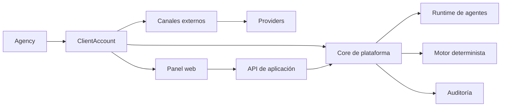
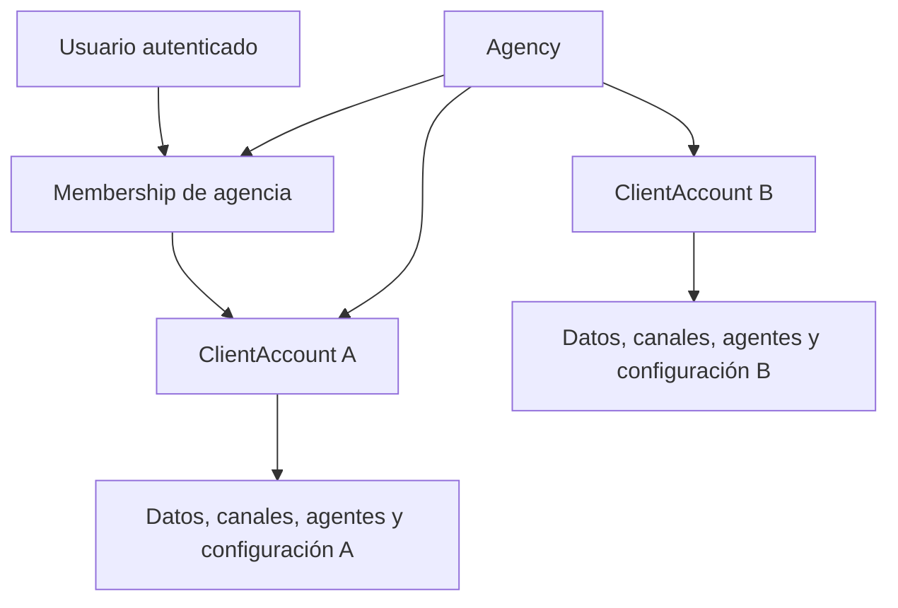
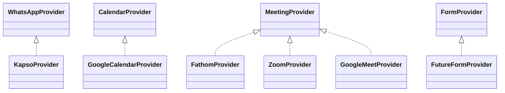

# Arquitectura de la plataforma SaaS inmobiliaria

## 1. Propósito y relación con la maqueta y el PDR

Este documento traduce el PDR de la plataforma de agencias de IA y la maqueta visual inmobiliaria en una arquitectura técnica coherente para implementar el producto por etapas. Define límites, responsabilidades, flujos de seguridad, aislamiento multi-tenant e interfaces de integración.

La maqueta sirve como referencia de experiencia y navegación. El PDR es la fuente de requisitos y alcance. La arquitectura propuesta no interpreta los datos visibles de la demo como datos persistidos ni sus indicadores como métricas reales.

### Qué representa la maqueta

- Un shell visual de agencia y cuenta cliente, con el contexto `Agencia / Principal` y `Aurea Realty`.
- Vistas previstas para Resumen, Inbox, Leads, Propiedades, Automatizaciones, Pipeline, Agenda, WhatsApp, Conocimiento, Métricas y Configuración.
- Conversaciones, leads, propiedades, flujos, eventos y métricas de ejemplo.
- Un modal de Atelier Operator que recibe lenguaje natural y muestra un texto indicando que prepara un borrador.
- Navegación local por hash y comportamiento responsive.

### Qué no está implementado en la maqueta

- Backend, base de datos, autenticación, autorización o persistencia.
- Integración real con WhatsApp/Kapso, calendario, reuniones o modelos de IA.
- Ejecución de automatizaciones, reintentos, colas, confirmaciones reales o auditoría.
- Secciones funcionales para Leads, Conocimiento, Métricas y Configuración.
- Un agente conversacional operativo. Los contadores, estados, conversaciones y propiedades son fixtures visuales.

## 2. Principios arquitectónicos y decisiones de alcance

| Principio | Decisión |
|---|---|
| Tenant explícito | Toda operación se ejecuta dentro de un `ClientAccount` resuelto y autorizado. |
| Runtime compartido | Los agentes usan un runtime compartido; el aislamiento se logra por contexto, scopes, permisos y validaciones, no mediante un proceso por cliente. |
| Ejecución controlada | El ciclo de acciones sensibles es interpretación → borrador → confirmación → ejecución → auditoría. |
| IA acotada | Los agentes proponen e interpretan; las herramientas validan y el motor ejecuta. |
| Automatización determinista | El motor sólo dispara sobre eventos estructurados y ya registrados, nunca sobre una inferencia subjetiva en curso. |
| Providers | Las integraciones externas se encapsulan detrás de interfaces estables. |
| Core separado del vertical | Agencias, usuarios, conversaciones, agentes, herramientas, automatizaciones y auditoría son core; propiedades, visitas y pipeline inmobiliario son módulos verticales. |
| Evolución incremental | MVP valida WhatsApp, CRM, agentes y automatizaciones; reuniones y campos personalizados son Fase 2; formularios son Fase 3. |

Quedan fuera de este diseño: white-label completo, facturación automatizada, mapas avanzados, portales, self-hosted, sandbox de ejecución, RAG empresarial avanzado y orquestación multi-agente compleja.

## 3. Contexto y límites del sistema

### Dentro del sistema

- Gestión de agencias, cuentas cliente, usuarios, roles y permisos.
- Datos comerciales por cuenta: contactos, leads, propiedades, conversaciones, tareas, visitas y pipeline.
- Configuración y ejecución mediada de agentes.
- Automatizaciones estructuradas, versiones, ejecuciones, esperas y reintentos.
- Normalización de eventos y auditoría.
- Panel web y APIs de aplicación.

### Fuera del sistema o detrás de un provider

- Transporte y entrega de WhatsApp.
- Proveedor de modelos de lenguaje.
- Calendarios externos.
- Grabación, transcripción y resumen de reuniones.
- Formularios externos futuros.

El sistema conserva referencias normalizadas y metadatos de integración; no debe asumir que controla la disponibilidad, latencia o formato original de un proveedor.

### Estrategia de base tecnológica y repositorio de partida

La implementación partirá de un **fork de WACRM** como base inicial, no de una implementación completamente independiente inspirada sólo en su experiencia visual. El fork permitirá reutilizar y adaptar progresivamente el frontend, el canvas y los componentes reutilizables que resulten compatibles con el producto propio.

El repositorio de origen/upstream se mantendrá separado del repositorio de producto y sincronizable mientras esa práctica siga siendo técnicamente viable. La relación con WACRM será una estrategia de implementación inicial, no una dependencia permanente del dominio: el core comercial y multi-tenant conservará control arquitectónico propio.

La adaptación debe respetar estos límites:

- `Agency → ClientAccount`, permisos, auditoría y providers son contratos del producto propio y no deben quedar acoplados a supuestos de WACRM.
- Las partes de WACRM que no cumplan esos contratos se sustituirán o encapsularán progresivamente detrás de interfaces propias.
- El frontend, el canvas y los componentes reutilizables se conservarán sólo cuando su comportamiento, seguridad y extensibilidad sean compatibles con el producto.
- La deuda de compatibilidad se registrará y se reducirá por etapas, sin convertir el fork en una colección de excepciones permanentes.

#### Criterios para conservar, adaptar o reemplazar

| Decisión | Criterio |
|---|---|
| Conservar | El componente tiene licencia compatible, calidad y seguridad aceptables, límites claros y encaja con los contratos de tenancy, permisos y auditoría. |
| Adaptar | La capacidad aporta valor, pero necesita encapsulamiento, cambios de interfaz o controles adicionales para cumplir el dominio propio. |
| Reemplazar | Existe acoplamiento fuerte al modelo de WACRM, riesgo de seguridad, extensibilidad insuficiente, deuda desproporcionada o incompatibilidad con el stack y los contratos propios. |

La auditoría de licencia es una **precondición** antes de usar o distribuir el fork. También deben evaluarse arquitectura, seguridad, extensibilidad, modelo de datos, compatibilidad con el stack y costo de mantener divergencias. Los riesgos principales son licencia, deuda técnica, incompatibilidad del modelo de datos, acoplamiento accidental y costo de divergencia respecto del upstream.

## 4. Arquitectura lógica por capas y módulos

| Capa | Responsabilidad | Regla de dependencia |
|---|---|---|
| Presentación | Shell, vistas, formularios, lienzo y centro de comando | No contiene reglas de negocio ni secretos de providers. |
| Aplicación | Casos de uso, resolución de cuenta, confirmaciones, comandos y consultas | Orquesta dominio, providers y jobs. |
| Dominio | Entidades, invariantes, permisos, eventos y estados | No conoce HTTP, UI ni SDKs externos. |
| Integración | Adaptadores `WhatsAppProvider`, `CalendarProvider`, `MeetingProvider` y futuro `FormProvider` | Traduce contratos externos a modelos internos. |
| Ejecución | Colas, workers, esperas, reintentos e idempotencia | Ejecuta sólo comandos autorizados y auditables. |
| Persistencia | Repositorios, almacenamiento de objetos y eventos | Todas las consultas requieren `client_account_id` y controles de scope. |

### Stack tecnológico de referencia

| Área | Dirección actual | Estado o límite |
|---|---|---|
| Interfaz y adaptación del frontend | Next.js, React y TypeScript | Base prevista para adaptar el frontend y el canvas del fork. |
| Estilos | CSS | Confirmado por la maqueta, que referencia un archivo CSS. Tailwind no está confirmado y queda pendiente. |
| API y servicios de aplicación | FastAPI y Python | Dirección prevista para casos de uso, contratos y servicios. |
| Agentes y orquestación | LangGraph | Dirección prevista para el runtime compartido de agentes. |
| Proveedor LLM | OpenAI/OpenRouter | Adaptador configurable según el PDR; no se fija un proveedor único. |
| Base de datos | Pendiente | Deben definirse tecnología, aislamiento y estrategia de row-level security. |
| Colas y workers | Pendiente | Deben definirse sistema, reintentos, idempotencia y operación. |
| Almacenamiento de objetos | Pendiente | Deben definirse proveedor, retención y controles de acceso. |
| Autenticación | Pendiente | Deben definirse mecanismo, sesiones, recuperación y gestión de credenciales. |
| Observabilidad | Pendiente | Deben definirse logs, métricas, trazas, alertas y evaluación de agentes. |

La selección de estas decisiones pendientes deberá preservar el aislamiento `Agency → ClientAccount`, los permisos, la auditoría y la independencia de providers. No se considera confirmada ninguna tecnología adicional por el solo hecho de aparecer en una propuesta futura.

## 5. Modelo multi-tenant y aislamiento `Agency → ClientAccount`

`Agency` agrupa la operación de una agencia administradora. `ClientAccount` es el tenant operativo de una inmobiliaria y la unidad mínima de aislamiento de datos, configuración, canales y agentes.

### Reglas de aislamiento

- Cada entidad de negocio tenant-scoped contiene `client_account_id`; no se infiere desde datos enviados por el cliente.
- La sesión selecciona un `ClientAccount` permitido por la membresía del usuario y el servidor lo verifica en cada caso de uso.
- Los repositorios aplican el scope de cuenta por defecto y rechazan consultas ambiguas.
- Las claves de proveedor, webhooks, índices de búsqueda y objetos almacenados se particionan por cuenta.
- El contexto del agente contiene cuenta, usuario, permisos, configuración y límites de herramientas; nunca recibe un conjunto global de datos.
- Los eventos incluyen `agency_id`, `client_account_id`, actor y correlación para impedir cruces silenciosos.
- Las tareas asíncronas serializan el scope y vuelven a validarlo antes de ejecutar.

La membresía de una agencia no implica acceso automático a todos los datos de todas sus cuentas: el permiso efectivo combina rol, relación con la cuenta y acción solicitada.

## 6. Módulos funcionales y responsabilidades

| Módulo | Responsabilidad | Etapa |
|---|---|---|
| Identidad y tenancy | Usuarios, membresías, cuentas, roles y selección de cuenta | MVP |
| Inbox | Conversaciones, mensajes, asignación, estado y derivación a humano | MVP |
| CRM inmobiliario | Leads, contactos, etiquetas, asesores, propiedades, ubicaciones, visitas y pipeline | MVP |
| Agente conversacional | Atención por canal, extracción y uso de herramientas permitidas | MVP |
| Agente operador | Consultas administrativas y borradores de automatizaciones o tareas | MVP |
| Automatizaciones | Flujos, triggers, condiciones, esperas, acciones, versiones y ejecuciones | MVP |
| Agenda | Seguimientos y visitas; calendario externo en Fase 2 | MVP / Fase 2 |
| WhatsApp | Conexión, webhooks, envío, entrega y reintentos | MVP |
| Conocimiento | Contenido contextual por cuenta para agentes | MVP, alcance detallado pendiente |
| Métricas | Consultas agregadas por cuenta y ejecuciones auditadas | MVP |
| Configuración | Configuración de agentes, herramientas, permisos e integraciones | MVP |
| Reuniones | Reuniones, transcripciones, resúmenes, participantes y acciones detectadas | Fase 2 |
| Campos personalizados | Esquema configurable por `ClientAccount` para contactos y extracciones | Fase 2 |
| Formularios | Captura nativa/externa y eventos de envío | Fase 3 |

## 7. Separación entre agentes IA, herramientas y motor de automatizaciones

### Agente conversacional

Atiende al lead en el contexto de una conversación. Puede buscar propiedades, extraer datos, proponer actualizaciones, clasificar, crear seguimientos o derivar a un humano, siempre usando herramientas habilitadas para la cuenta.

### Agente operador

Interactúa con usuarios del panel, no con leads. Convierte lenguaje natural en consultas, tareas o un borrador de flujo. No publica ni activa una automatización por sí mismo.

### Herramientas

Las tools son contratos pequeños y validados, por ejemplo `search_properties`, `extract_lead_data`, `create_lead`, `update_lead`, `add_tag`, `notify_advisor`, `create_followup` y `handoff_to_human`. En Fase 2 se agregan `list_meetings`, `get_meeting_summary`, `update_contact`, `create_task`, `create_calendar_event` y `add_tag` normalizadas.

Cada invocación valida cuenta, identidad del actor, permiso, payload, estado y política de confirmación. Una respuesta del modelo no es una ejecución.

### Motor determinista

Consume eventos estructurados como `message.received`, `tag.added`, `lead.stage_changed`, `followup.due` o `meeting.summary.created`. Evalúa condiciones declarativas y ejecuta acciones versionadas con idempotencia, reintentos y auditoría.

La etiqueta aplicada puede ser un puente válido entre agente y motor. El trigger no debe ser “el agente dedujo interés”, sino el evento consumado “se aplicó la etiqueta `interesado`”. El motor no dispara sobre inferencias subjetivas sin un evento estructurado.

## 8. Modelo conceptual de entidades y relaciones

| Entidad | Relaciones y propósito |
|---|---|
| `Agency` | Tiene muchas `ClientAccount` y membresías. |
| `ClientAccount` | Tenant de usuarios, canales, configuración, agentes y datos verticales. |
| `User` / `Membership` | Identidad y relación con agencia/cuenta, rol y permisos. |
| `AgentConfig` | Prompt, modelo, tono, horarios, herramientas, permisos y reglas de derivación por cuenta. |
| `Channel` | Configuración normalizada de WhatsApp y provider asociado. |
| `Contact` / `Lead` | Persona y oportunidad comercial; un lead puede referenciar conversaciones y propiedades. |
| `Conversation` / `Message` | Hilo y mensajes recibidos/enviados, con actor y canal. |
| `Property` | Inmueble de la cuenta, con operación, ubicación y atributos verticales. |
| `Pipeline` / `Stage` | Estados configurables de oportunidades. |
| `Task` / `Followup` / `Appointment` | Trabajo pendiente, seguimiento programado y visita. |
| `Automation` / `AutomationVersion` | Flujo editable, estado, versión confirmada y definición estructurada. |
| `AutomationRun` | Ejecución, pasos, resultados, errores, reintentos e idempotency key. |
| `DomainEvent` | Hecho estructurado que habilita automatizaciones y trazabilidad. |
| `AuditLog` | Registro inmutable de actor, origen, cuenta, acción, objeto, resultado y correlación. |
| `Meeting` / `MeetingArtifact` | Reunión y grabación, transcripción, resumen o extracción de Fase 2. |
| `CustomFieldDefinition` / `CustomFieldValue` | Definición y valor tipado pertenecientes a una cuenta. |

Relaciones esenciales: `Agency 1:N ClientAccount`; `ClientAccount 1:N` todas las entidades operativas; `Contact 1:N Conversation/Meeting`; `Automation 1:N AutomationVersion/AutomationRun`; `DomainEvent 1:N AutomationRun` potenciales.

## 9. Integraciones mediante providers

Los contratos internos deben normalizar identificadores externos, timestamps, estados, errores, paginación, webhooks y correlación. Cada conexión pertenece a un `ClientAccount` y sus credenciales se almacenan fuera de la lógica de dominio.

| Provider | MVP | Fase 2 | Fase 3 |
|---|---:|---:|---:|
| `WhatsAppProvider` | `KapsoProvider` | Meta Cloud API posible | Otros proveedores posibles |
| `CalendarProvider` | No | `GoogleCalendarProvider` posible | Extensible |
| `MeetingProvider` | No | Fathom, Zoom, Google Meet posibles | Extensible |
| `FormProvider` | No | No | Formularios nativos/externos |

No se fija aún un proveedor único de reuniones ni el detalle de OAuth, retención de grabaciones o permisos de calendario; deben definirse antes de Fase 2.

## 10. Flujo de datos de Inbox y del agente

1. El provider recibe un webhook y lo valida, deduplica y normaliza.
2. Se crea un `DomainEvent` y un `Message` dentro del `ClientAccount` asociado al canal.
3. El Inbox actualiza la conversación y asignación, y publica el evento interno.
4. El orquestador construye contexto mínimo: cuenta, conversación, conocimiento autorizado y configuración vigente.
5. El agente conversacional genera una respuesta o una invocación de herramienta.
6. La herramienta valida scope, permiso y payload; una acción sensible produce un borrador o comando pendiente.
7. El sistema solicita confirmación humana cuando la política lo exige; no se confunde una sugerencia con una ejecución.
8. El executor envía respuestas o aplica cambios mediante comandos idempotentes.
9. Se registra `AuditLog`, resultado y eventos derivados para el motor determinista.

Los envíos al provider deben ser reintentables y deduplicables. Una falla externa no debe generar dos mensajes ni dos actualizaciones de lead.

## 11. Flujo de reuniones de Fase 2

1. `MeetingProvider` notifica una reunión asociada a una cuenta y, cuando sea posible, a un contacto.
2. El adaptador normaliza reunión, participantes, fecha, duración, grabación y artefactos disponibles.
3. La transcripción y el resumen se almacenan con controles de acceso y retención definidos.
4. El agente extrae datos, próximos pasos y posibles acciones en una propuesta estructurada.
5. El usuario revisa la extracción y confirma las actualizaciones o el borrador de automatización cuando corresponda.
6. El motor ejecuta acciones confirmadas, por ejemplo actualizar contacto, crear tarea, crear evento o agregar etiqueta.
7. Se emiten eventos como `meeting.summary.created` y se audita origen, evidencia, decisión, ejecución y resultado.

Las acciones detectadas en una reunión son insumos para revisión y automatización, no ejecuciones directas del agente. Una inferencia como “intención de compra alta” no puede disparar por sí sola una automatización: debe convertirse en un dato estructurado revisable y, cuando corresponda, confirmado por una persona.

## 12. Campos personalizados por cuenta

`CustomFieldDefinition` pertenece a un `ClientAccount` y define nombre, tipo, obligatoriedad, opciones, entidad objetivo y reglas de extracción. `CustomFieldValue` referencia la definición y el registro concreto, siempre dentro de la misma cuenta.

Ejemplos: presupuesto, tipo de operación, zona preferida, dormitorios, fecha estimada, nivel de interés y origen del lead.

Requisitos de diseño:

- No existe un catálogo global mutable que mezcle configuraciones de inmobiliarias.
- El agente sólo puede leer/escribir campos habilitados y permitidos para esa cuenta.
- Las extracciones informan valor, confianza, fuente y evidencia; no convierten texto incierto en hecho silenciosamente.
- Los cambios de definición son versionables y no deben destruir valores históricos.
- Métricas y automatizaciones validan tipo y versión del campo antes de operar.

## 13. Seguridad, permisos, confirmación y auditoría

### Permisos

La autorización combina identidad, membresía, `ClientAccount`, rol, acción y recurso. Las tools tienen habilitación por cuenta y permisos separados; habilitar una tool no equivale a autorizar todas sus operaciones.

### Confirmación

Se requiere confirmación explícita antes de activar una automatización nueva o modificada y antes de cualquier acción sensible definida por la política de la cuenta. El borrador conserva quién lo generó, qué datos usó, qué cambios propone y qué versión se confirmó.

### Auditoría

Cada acción registra como mínimo:

| Campo | Contenido |
|---|---|
| Actor y origen | Usuario, agente, motor, webhook o provider. |
| Scope | `agency_id`, `client_account_id`, rol y permisos evaluados. |
| Acción | Tool/comando, recurso, versión y parámetros sanitizados. |
| Tiempo y correlación | Timestamp, request/job/event/correlation ID. |
| Decisión | Borrador, confirmación, rechazo o ejecución automática. |
| Resultado | Éxito, error, reintento, respuesta externa e impacto. |

Los secretos no deben aparecer en logs. Se deben definir retención, exportación, acceso administrativo y tratamiento de datos personales antes del piloto productivo.

## 14. Evolución por MVP, Fase 2 y Fase 3

| Etapa | Entrega arquitectónica | Criterio de no expansión |
|---|---|---|
| MVP | Tenancy, Inbox/WhatsApp Kapso, CRM inmobiliario, agentes, tools básicas, automatizaciones visuales y por lenguaje natural, confirmación, ejecución, auditoría y métricas básicas. | Validar operación con una agencia piloto antes de sumar canales o complejidad. |
| Fase 2 | Reuniones, `MeetingProvider`, `CalendarProvider`, resúmenes, extracciones, campos personalizados y automatizaciones post-reunión. | Mantener revisión humana y eventos estructurados; no ejecutar inferencias libres. |
| Fase 3 | `FormProvider`, formularios nativos/externos, captura automática y capacidades multicanal/reportes posteriores. | Definir contratos a partir de aprendizajes de Fase 2. |

El core debe permanecer estable mientras los módulos verticales y providers evolucionan por separado.

## 15. Correspondencia entre maqueta y componentes reales

| Vista o elemento visual | Componente real previsto | Estado en la maqueta |
|---|---|---|
| Shell, selector y breadcrumb | `AgencyContext` y selector de `ClientAccount` | Visual; no resuelve tenancy real. |
| Resumen y tarjetas | `DashboardQueryService` y métricas agregadas | Fixtures estáticos. |
| Inbox y conversaciones | Inbox, mensajes, webhooks y `WhatsAppProvider` | Lista visual; sin canal ni persistencia. |
| Leads y Pipeline | CRM, etapas, etiquetas y búsquedas | Leads no tiene sección asociada en el HTML; pipeline es demostrativo. |
| Propiedades | Catálogo inmobiliario y búsqueda acotada | Fixtures visuales. |
| Automatizaciones | Editor de flujos, versiones, confirmación y executor | Flujos visibles; los botones no crean ni ejecutan. |
| Agenda | Tareas, visitas y luego calendario externo | Eventos visuales; no existe integración. |
| WhatsApp | Gestión de conexión y webhooks | Texto “vía Kapso” en la demo, no conexión real. |
| Atelier Operator | API de comandos, agente operador y borradores | Modal estático; JavaScript sólo imprime una interpretación textual. |
| Conocimiento | Repositorio de contenido por cuenta | Sólo enlace visual. |
| Métricas | Consultas sobre eventos y ejecuciones auditadas | Sólo indicadores de ejemplo. |
| Configuración | Configuración de agentes, tools, permisos e integraciones | Sólo enlace visual. |
| Reuniones | Módulo Fase 2, artefactos y extracción revisable | No representado funcionalmente; previsto por el PDR. |

## 16. Riesgos, decisiones pendientes y próximos pasos

### Riesgos principales

- Un runtime compartido puede filtrar contexto si una consulta, prompt, job o cache omite el scope de cuenta.
- Acciones de agentes sin confirmación o sin idempotencia pueden modificar datos reales de forma no deseada.
- Kapso puede introducir límites, cambios de API o fallos de entrega; el provider debe aislarlos.
- Transcripciones y resúmenes contienen datos sensibles y requieren retención y control de acceso.
- Los campos personalizados y las extracciones pueden generar esquemas inconsistentes si no se validan por tipo y versión.

### Decisiones pendientes

- Base de datos, estrategia de row-level security y almacenamiento de objetos.
- Sistema de colas/workers y política concreta de reintentos.
- Modelo detallado de roles, permisos y acciones que siempre requieren confirmación.
- Contrato de eventos, versionado e idempotencia.
- Proveedor de modelos, observabilidad, límites de costo y evaluación de respuestas.
- OAuth, scopes, retención y proveedor inicial de reuniones/calendario.
- Política de privacidad, retención, borrado y exportación de datos.

### Próximos pasos

1. Convertir `Agency`, `ClientAccount`, membresías, permisos y eventos en contratos de dominio.
2. Definir el esquema persistente con aislamiento obligatorio y pruebas de acceso cruzado.
3. Especificar contratos de `WhatsAppProvider`, webhooks, normalización e idempotencia.
4. Diseñar el modelo versionado de automatizaciones y su ciclo de confirmación.
5. Implementar primero el camino Inbox → agente → tool validada → evento → auditoría.
6. Definir observabilidad y criterios de éxito del piloto antes de activar Fase 2.
7. Diseñar reuniones y campos personalizados como extensiones de los contratos, no como excepciones del core.
